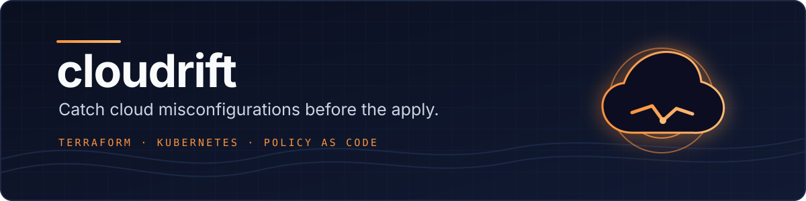
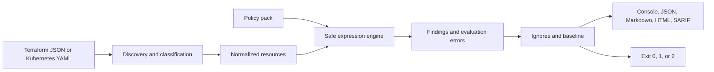

<p align="center">
  
</p>

<p align="center">
  <a href="https://github.com/dev-rudran/cloudrift/actions/workflows/ci.yml"></a>
  
  
  
  
  
</p>

`cloudrift` is a policy-as-code misconfiguration scanner for Terraform plan and
state JSON and Kubernetes YAML. It evaluates a declarative policy pack against
serialized infrastructure, explains what is exposed, and fails CI before a
dangerous change is applied.

- **Offline and credential-free.** No cloud API calls, no agents, no Terraform
  or kubectl binary required.
- **Terraform-aware.** Understands plans, state, modules, replacements, and
  cross-resource references.
- **Kubernetes-aware.** Handles multi-document YAML, `List` objects, workload
  templates, RBAC, namespaces, and source line tracking.
- **Safe policy language.** A validated expression interpreter, never `eval`.
- **Built for automation.** Console, JSON, Markdown, HTML, and SARIF 2.1.0
  output, severity gates, expiring ignores, and baselines for existing debt.

## Install

Python 3.10 or newer is required. The only runtime dependency is PyYAML.

```console
$ python3 -m venv .venv
$ . .venv/bin/activate
$ python -m pip install .
$ cloudrift version
cloudrift 0.1.0
```

For development, install the editable package with test and lint tools:

```console
$ python -m pip install -e ".[dev]"
$ pytest
```

`cloudrift` is pre-1.0 and is installed from source. A PyPI release is not yet
available.

## Quick start

Scan the deliberately vulnerable example. It contains a Terraform plan and a
Kubernetes application:

```console
$ cloudrift scan examples/vulnerable --no-color
cloudrift 0.1.0
Targets: examples/vulnerable
Policies: 49   Resources: 23

CRITICAL (8)
  CLDR-0001  S3 bucket ACL grants public access
    resource: aws_s3_bucket.logs
    location: examples/vulnerable/plan.json
    S3 bucket logs uses an ACL that grants public access. Anonymous or cross-account readers may be able to list or read objects.
    fix: Set acl = "private" and remove public grants. Use bucket policies with explicit principals and conditions when sharing is required.

  CLDR-0002  S3 bucket policy allows a public principal
    resource: aws_s3_bucket_policy.logs
    location: examples/vulnerable/plan.json
    The bucket policy for logs contains an Allow statement for Principal "*" without a Condition.
    fix: Restrict Principal to known accounts, roles, or services, and add conditions such as aws:SourceVpce or aws:PrincipalOrgID.

  ... 6 more critical findings, 19 high, 16 medium, 7 low, 1 info ...

Summary  51 findings (critical 8, high 19, medium 16, low 7, info 1)
         resources 23 | policies 49 | evaluations 57 | suppressed 0
Result   FAIL (gate: high)
```

The process exits 1 because findings meet the default `high` gate. Only part of
the critical section is shown above. This command displays the full critical
section without failing the shell:

```console
$ cloudrift scan examples/vulnerable --severity critical --fail-on never
```

<details>
<summary>Full compact output (51 findings, exit 1)</summary>

```console
$ cloudrift scan examples/vulnerable --quiet --no-color
CLDR-0001 critical aws_s3_bucket.logs examples/vulnerable/plan.json S3 bucket ACL grants public access
CLDR-0002 critical aws_s3_bucket_policy.logs examples/vulnerable/plan.json S3 bucket policy allows a public principal
CLDR-0013 critical aws_iam_policy.admin examples/vulnerable/plan.json IAM policy grants full administrative access
CLDR-0014 critical aws_iam_access_key.root examples/vulnerable/plan.json Root account access key is declared
CLDR-0016 critical aws_db_instance.main examples/vulnerable/plan.json RDS instance is publicly accessible
CLDR-0031 critical aws_instance.web examples/vulnerable/plan.json Public instance exposes SSH to the internet
CLDR-1001 critical kubernetes_deployment.default.web examples/vulnerable/k8s/app.yaml:25 Container runs in privileged mode
CLDR-1012 critical kubernetes_cluster_role_binding.alice-admin examples/vulnerable/k8s/app.yaml:78 cluster-admin is bound to a non-system subject
CLDR-0003 high aws_s3_bucket.logs examples/vulnerable/plan.json S3 bucket has no default encryption
CLDR-0006 high aws_security_group.web examples/vulnerable/plan.json SSH is open to the internet
CLDR-0007 high aws_security_group.web examples/vulnerable/plan.json RDP is open to the internet
CLDR-0008 high aws_security_group.web examples/vulnerable/plan.json MySQL is open to the internet
CLDR-0009 high aws_security_group.web examples/vulnerable/plan.json PostgreSQL is open to the internet
CLDR-0010 high aws_security_group.web examples/vulnerable/plan.json Security group allows all ports from the internet
CLDR-0011 high aws_iam_policy.admin examples/vulnerable/plan.json IAM policy allows wildcard actions
CLDR-0017 high aws_db_instance.main examples/vulnerable/plan.json RDS storage is not encrypted
CLDR-0020 high aws_ebs_volume.data examples/vulnerable/plan.json EBS volume is unencrypted
CLDR-0021 high aws_cloudtrail.main examples/vulnerable/plan.json CloudTrail logging is disabled
CLDR-0024 high aws_lb_listener.http examples/vulnerable/plan.json Load balancer listener uses HTTP
CLDR-0025 high aws_lambda_function.api examples/vulnerable/plan.json Lambda environment contains a secret-like value
CLDR-1002 high kubernetes_deployment.default.web examples/vulnerable/k8s/app.yaml:25 Container allows privilege escalation
CLDR-1004 high kubernetes_deployment.default.web examples/vulnerable/k8s/app.yaml:25 Container adds dangerous Linux capabilities
CLDR-1005 high kubernetes_deployment.default.web examples/vulnerable/k8s/app.yaml:21 Pod mounts a hostPath volume
CLDR-1006 high kubernetes_deployment.default.web examples/vulnerable/k8s/app.yaml:1 Pod shares a host namespace
CLDR-1011 high kubernetes_cluster_role.platform-admin examples/vulnerable/k8s/app.yaml:65 RBAC role grants wildcard permissions
CLDR-1013 high kubernetes_secret.default.db examples/vulnerable/k8s/app.yaml:45 Secret manifest contains literal data
CLDR-1014 high kubernetes_deployment.default.web examples/vulnerable/k8s/app.yaml:25 Container environment contains a secret-like literal
CLDR-0004 medium aws_s3_bucket.logs examples/vulnerable/plan.json S3 bucket versioning is disabled
CLDR-0012 medium aws_iam_policy.admin examples/vulnerable/plan.json IAM policy allows all resources
CLDR-0015 medium aws_iam_access_key.root examples/vulnerable/plan.json IAM access key is older than 90 days
CLDR-0018 medium aws_db_instance.main examples/vulnerable/plan.json RDS automated backups are disabled
CLDR-0023 medium aws_kms_key.main examples/vulnerable/plan.json KMS key rotation is disabled
CLDR-0026 medium aws_vpc.main examples/vulnerable/plan.json VPC has no flow logs
CLDR-0027 medium aws_sqs_queue.jobs examples/vulnerable/plan.json SQS queue is not encrypted
CLDR-0028 medium aws_sns_topic.alerts examples/vulnerable/plan.json SNS topic is not encrypted
CLDR-0029 medium aws_ecr_repository.app examples/vulnerable/plan.json ECR repository does not scan images on push
CLDR-0030 medium aws_secretsmanager_secret.db examples/vulnerable/plan.json Secrets Manager secret has no rotation
CLDR-1003 medium kubernetes_deployment.default.web examples/vulnerable/k8s/app.yaml:25 Container may run as root
CLDR-1007 medium kubernetes_deployment.default.web examples/vulnerable/k8s/app.yaml:25 Container image uses a mutable tag
CLDR-1008 medium kubernetes_deployment.default.web examples/vulnerable/k8s/app.yaml:25 Container has no CPU or memory limits
CLDR-1010 medium kubernetes_deployment.default.web examples/vulnerable/k8s/app.yaml:1 Service account token is auto-mounted
CLDR-1015 medium kubernetes_deployment.default.web examples/vulnerable/k8s/app.yaml:1 Container disables seccomp confinement
CLDR-1017 medium kubernetes_deployment.default.web examples/vulnerable/k8s/app.yaml:1 Namespace has no NetworkPolicy
CLDR-0005 low aws_s3_bucket.logs examples/vulnerable/plan.json S3 bucket access logging is disabled
CLDR-0019 low aws_db_instance.main examples/vulnerable/plan.json RDS deletion protection is disabled
CLDR-0022 low aws_cloudtrail.main examples/vulnerable/plan.json CloudTrail trail is not multi-region
CLDR-1009 low kubernetes_deployment.default.web examples/vulnerable/k8s/app.yaml:1 Resource uses the default namespace
CLDR-1009 low kubernetes_secret.default.db examples/vulnerable/k8s/app.yaml:39 Resource uses the default namespace
CLDR-1009 low kubernetes_service.default.web examples/vulnerable/k8s/app.yaml:48 Resource uses the default namespace
CLDR-1016 low kubernetes_deployment.default.web examples/vulnerable/k8s/app.yaml:25 Container root filesystem is writable
CLDR-1018 info kubernetes_service.default.web examples/vulnerable/k8s/app.yaml:48 LoadBalancer Service has no internal annotation
Result FAIL
```

</details>

The compliant example produces no findings and exits 0:

```console
$ cloudrift scan examples/compliant --no-color
cloudrift 0.1.0
Targets: examples/compliant
Policies: 49   Resources: 25

No findings.
Summary  0 findings (critical 0, high 0, medium 0, low 0, info 0)
         resources 25 | policies 49 | evaluations 53 | suppressed 0
Result   PASS (gate: high)
```

Read from stdin and write SARIF for code scanning:

```console
$ terraform show -json plan.tfplan | cloudrift scan - --format sarif --output cloudrift.sarif
$ cloudrift scan manifests/ --format json --severity medium --fail-on high
$ cloudrift scan examples/vulnerable --format html --output cloudrift.html
```

## What it scans

| Input | Supported |
| --- | --- |
| `terraform show -json plan.tfplan` | Planned values, replacements, child modules, references |
| `terraform show -json` on a state file | `values.root_module`, `prior_state`, references |
| Kubernetes YAML | Multi-document streams, `kind: List`, top-level sequences |
| Kubernetes workloads | Pod, Deployment, StatefulSet, DaemonSet, ReplicaSet, ReplicationController, Job, CronJob |
| Kubernetes RBAC | Role, ClusterRole, RoleBinding, ClusterRoleBinding |
| Stdin | `-`, auto-detected as Terraform JSON or Kubernetes YAML |

Data sources are skipped. Delete-only resource changes are ignored. Missing or
unknown plan values are treated as `None`; policies use explicit guards such as
`exists()` rather than assuming an attribute is present.

## Policies

The bundled pack has **49 policies**: 31 AWS and 18 Kubernetes.

| Area | Examples |
| --- | --- |
| AWS storage | Public S3 ACLs and policies, missing encryption, versioning, access logging |
| AWS network | Internet-exposed SSH, RDP, MySQL, PostgreSQL, all-port security groups, HTTP listeners, VPC flow logs |
| AWS identity | Wildcard and administrative IAM policies, root access keys, stale keys |
| AWS data | Public or unencrypted RDS, backups, deletion protection, unencrypted EBS |
| AWS platform | CloudTrail, KMS rotation, Lambda secrets, SQS and SNS encryption, ECR scanning, secret rotation |
| Kubernetes workloads | Privileged containers, privilege escalation, root users, capabilities, hostPath, host namespaces, mutable tags, limits, seccomp, writable root filesystem |
| Kubernetes access | RBAC wildcards, cluster-admin bindings, default namespaces, token auto-mount |
| Kubernetes data and network | Literal Secrets, secret-like environment values, LoadBalancer exposure, missing NetworkPolicy |

Run `cloudrift rules list` to see the full pack, or read
[docs/POLICIES.md](docs/POLICIES.md) for every ID, the schema, and the expression
language.

```console
$ cloudrift rules show CLDR-0006
CLDR-0006  SSH is open to the internet
Severity:    high
Provider:    aws
Resources:   aws_security_group, aws_security_group_rule
Tags:        ec2, network, ssh, public-access, cis-aws-5.2

Description: A security group ingress rule allows SSH from a public CIDR. Internet exposure of port 22 is routinely scanned and attacked.
...
```

## Commands

```text
cloudrift scan [paths ...] [options]     scan files, directories, or stdin
cloudrift rules list                    list the active policy pack
cloudrift rules show ID                 show one policy
cloudrift rules validate [path]         validate a policy pack
cloudrift explain ID                    explain evaluation and relations
cloudrift version                       print the version
```

Frequently used scan options:

| Option | Purpose |
| --- | --- |
| `--format, -f` | `console`, `json`, `md`, `markdown`, `sarif`, or `html`. |
| `--output, -o` | Write the report to a file. A `.html` path selects HTML by default. |
| `--severity` | Report and gate only at or above this severity. |
| `--fail-on` | Exit 1 at this severity, or `never`. Defaults to `high`. |
| `--policy-dir` | Replace the bundled pack with a file or directory. |
| `--config` | Use a specific `cloudrift.yaml`. |
| `--ignore ID` | Suppress a policy for this run; repeatable, globs allowed. |
| `--baseline FILE` | Gate only on findings that are not in the baseline. |
| `--write-baseline FILE` | Write current findings as a baseline and continue. |
| `--quiet, -q` | One line per finding; suppress headers and summary. |
| `--stats` | Add evaluation timing and provider counts to the console report. |
| `--no-color` | Disable ANSI colors. |

Exit codes are stable:

| Code | Meaning |
| --- | --- |
| 0 | No finding met the gate. |
| 1 | At least one finding met the gate. |
| 2 | Usage, input, config, baseline, policy, or evaluation error. |

## Reports

### JSON

The JSON report has `schema_version: "1.0"`, stable field names, and a summary
that includes gate and baseline state.

```json
{
  "policy_id": "CLDR-0001",
  "title": "S3 bucket ACL grants public access",
  "severity": "critical",
  "message": "S3 bucket logs uses an ACL that grants public access. Anonymous or cross-account readers may be able to list or read objects.",
  "remediation": "Set acl = \"private\" and remove public grants. Use bucket policies with explicit principals and conditions when sharing is required.",
  "resource": "aws_s3_bucket.logs",
  "resource_type": "aws_s3_bucket",
  "provider": "aws",
  "file": "examples/vulnerable/plan.json",
  "line": null,
  "location": "examples/vulnerable/plan.json",
  "references": [
    "https://docs.aws.amazon.com/AmazonS3/latest/userguide/access-control-block-public-access.html"
  ],
  "tags": ["s3", "storage", "public-access", "cis-aws-2.1.5"],
  "fingerprint": "4d729ff842d067a5"
}
```

Top-level keys are `schema_version`, `tool`, `scan`, `summary`, `findings`,
`resources`, `suppressed`, `stale_ignores`, and `errors`. The summary includes
severity counts, policy and resource counts, evaluation count, gate state,
baseline drift, and the exit code.

### SARIF

SARIF 2.1.0 output includes rule metadata, severity levels, physical and
logical locations, help URIs, and partial fingerprints for deduplication.

```json
{
  "ruleId": "CLDR-0001",
  "level": "error",
  "message": {
    "text": "S3 bucket logs uses an ACL that grants public access. Anonymous or cross-account readers may be able to list or read objects."
  },
  "locations": [
    {
      "physicalLocation": {
        "artifactLocation": {"uri": "examples/vulnerable/plan.json"}
      },
      "logicalLocations": [
        {"fullyQualifiedName": "aws_s3_bucket.logs", "kind": "resource"}
      ]
    }
  ],
  "partialFingerprints": {"cloudrift/v1": "4d729ff842d067a5"}
}
```

### Markdown

`--format markdown` writes a table-oriented report suitable for pull request
comments and job summaries. Markdown cells are escaped so resource names cannot
inject HTML or break tables.

### HTML

`--format html` writes one self-contained file with inline CSS and JavaScript.
Severity filters, free-text search, and severity grouping work offline with no
external requests. A `.html` or `.htm` output path selects this format when
`--format` is omitted.

## Configuration

`cloudrift` auto-discovers `cloudrift.yaml`, `cloudrift.yml`,
`.cloudrift.yaml`, or `.cloudrift.yml` in the working directory. Use
`--config` to point elsewhere.

```yaml
# cloudrift.yaml
fail_on: high
severity: info

exclude_paths:
  - "*/vendor/*"
  - "examples/legacy/**"

ignore:
  - id: CLDR-0018
    resource: "aws_db_instance.reporting_*"
    reason: "Legacy reporting database; migration tracked in SEC-142"
    expires: 2026-06-30

  - id: CLDR-1007
    resource: "kubernetes_deployment.default.canary"
    reason: "Mutable tag accepted for the canary rollout"
    expires: 2026-03-01
```

Ignored findings are counted as suppressed. Expired rules are listed as stale
and never suppress. Unknown configuration keys are errors, so typos do not
silently weaken the gate.

## Baselines

Adopting a scanner on an existing repository should not require fixing every
historical finding first. Record a baseline, then gate only on drift:

```console
$ cloudrift scan infra/plan.json k8s/ --baseline cloudrift-baseline.json --fail-on high
```

When a baseline is active, the console summary shows new, existing, and fixed
counts:

```text
Summary  51 findings (critical 8, high 19, medium 16, low 7, info 1)
         resources 23 | policies 49 | evaluations 57 | suppressed 0
         baseline new 0 | existing 51 | fixed 0
Result   PASS (gate: high)
```

Create or refresh the baseline with `--write-baseline`, which writes the current
findings after ignores and continues the scan. Fingerprints are derived from
policy ID, resource address, and source file, so line changes do not create
false drift. Paths inside the working directory are normalized to relative
paths to keep baselines portable across CI and developer machines.

## CI integration

The exit code is the gate. A minimal GitHub Actions job can publish SARIF at the
same time:

```yaml
name: cloudrift

on: [pull_request]

permissions:
  contents: read
  security-events: write

jobs:
  scan:
    runs-on: ubuntu-latest
    steps:
      - uses: actions/checkout@v4
      - uses: actions/setup-python@v5
        with:
          python-version: "3.13"
      - run: python -m pip install .
      - name: Scan
        run: cloudrift scan infra/ k8s/ --format sarif --output cloudrift.sarif --fail-on high
      - name: Upload SARIF
        if: always()
        uses: github/codeql-action/upload-sarif@v3
        with:
          sarif_file: cloudrift.sarif
```

Use `--fail-on never` when you want visibility without blocking a pipeline, or
`--severity high` to keep low-noise findings out of both the report and the
gate. A runtime policy evaluation failure always exits 2.

## Writing policies

Policies are YAML. Assertions are true when a resource is compliant. This is a
complete policy:

```yaml
policies:
  - id: CLDR-9001
    title: Bucket must be private
    description: Local policy used by the platform team.
    severity: high
    provider: aws
    resource: aws_s3_bucket
    assert: resource.acl == "private"
    message: Bucket {name} is not private.
    remediation: Set acl = "private".
```

Validate it and scan with it:

```console
$ cloudrift rules validate ./policies
1 policies valid
$ cloudrift scan examples/vulnerable/plan.json --policy-dir ./policies
```

`--policy-dir` replaces the bundled pack rather than merging with it, which
keeps custom scans reproducible. Expressions support boolean logic, comparisons,
comprehensions, safe attribute access, and pure helpers such as
`is_public_cidr`, `iam_allow_all`, `sg_ingress_rules`, and `image_tag`. There are
no imports, lambdas, method calls, or filesystem access. See
[docs/POLICIES.md](docs/POLICIES.md).

## Architecture



The CLI owns I/O and process status. Inputs are normalized into one `Resource`
model, policies are schema-validated and compiled to a restricted AST, and every
report format renders the same `ScanContext`. See
[docs/ARCHITECTURE.md](docs/ARCHITECTURE.md) for module boundaries, relation
resolution, and design tradeoffs.

## Security

- YAML is loaded with a safe constructor; Python-specific tags are rejected.
- Policy expressions are validated and interpreted, never executed.
- AST size, depth, step count, regex length, and payload sizes are bounded.
- Reports escape untrusted text for their output context.
- No scanner code calls cloud APIs or reads credentials.

Report vulnerabilities privately to **rudraking2404@gmail.com**. The full threat
model and disclosure process are in [SECURITY.md](SECURITY.md).

## Development

```console
$ python -m pip install -e ".[dev]"
$ pytest
$ ruff check .
$ ruff format --check .
$ bandit -r src
```

Or run `make check`. The suite has 390 tests and covers all 49 bundled policies
in both vulnerable and compliant directions, hostile expression inputs, input
detection, Terraform and Kubernetes ingestion, configuration, baselines, every
report format, and the CLI end to end. CI runs Python 3.10, 3.11, 3.12, and
3.13.

See [CONTRIBUTING.md](CONTRIBUTING.md) before sending a change.

## Limitations

- Terraform HCL is not parsed. Generate JSON with `terraform show -json`.
- Unknown plan values stay unknown; a later apply can differ from the plan.
- Cross-resource relation resolution is a documented heuristic, not a complete
  Terraform dependency graph.
- Only manifests are inspected. Live cluster state and admission control are
  out of scope.
- The bundled pack is a practical baseline, not a compliance certification.
  Extend or replace it for your environment.

## License

MIT. Copyright (c) 2026 Rudra Tushir. See [LICENSE](LICENSE).
