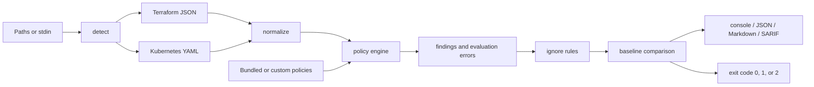

# Architecture

`cloudrift` is a single-process scanner with no network, cloud credentials, or
daemon dependency. It reads serialized infrastructure, normalizes it into a
small resource model, evaluates policy expressions, and writes one report.

## Pipeline



1. **Discovery** (`inputs/detect.py`) expands files and directories, skips
   dependency and VCS directories, and classifies content by suffix and shape.
   A `.json` document is Terraform when it has `planned_values`,
   `resource_changes`, or a `values.root_module`; a YAML document is
   Kubernetes when it has a string `kind`.
2. **Ingestion** builds resources from Terraform plan/state JSON
   (`inputs/terraform.py`) or multi-document Kubernetes YAML
   (`inputs/kubernetes.py`). Unsupported explicit paths fail with exit code 2.
3. **Normalization** (`inputs/normalize.py`) assigns every resource a stable
   address, a provider, a namespace where applicable, and a source location.
4. **Evaluation** (`policy/engine.py`) sorts policies by ID and resources by
   address, applies resource globs, resolves relations, and evaluates the
   assertion in the safe interpreter (`policy/expr.py`).
5. **Policy** (`config.py`, `baseline.py`) applies expiring ignores and optional
   baseline drift classification.
6. **Reporting** (`report/`) renders the same `ScanContext` into console, JSON,
   Markdown, or SARIF without duplicating scan logic.

The CLI (`cli.py`) owns process concerns: argument parsing, stdin, output files,
severity filtering, gating, and exit codes. Library code never calls
`sys.exit`.

## Package layout

```text
src/cloudrift/
  cli.py                 argument parsing and exit codes
  config.py              cloudrift.yaml, ignore rules, expiry
  baseline.py            fingerprinting and drift comparison
  models.py              Resource, Policy, Finding, Severity, ScanContext
  errors.py              expected user-facing exceptions
  inputs/
    detect.py            discovery and content classification
    terraform.py         plan and state JSON
    kubernetes.py        YAML streams, Lists, workload extraction
    normalize.py         canonical addresses and resource views
  policy/
    loader.py            schema validation and policy pack loading
    engine.py            matching, relation resolution, finding creation
    expr.py              AST validator and interpreter
    builtins.py          pure helper functions exposed to policies
  report/
    console.py           human-readable report
    html.py              self-contained offline HTML report
    json_report.py       stable machine schema
    markdown.py          pull-request friendly report
    sarif.py             SARIF 2.1.0 for code scanning
  util/
    cidr.py              network and public-range classification
    text.py              terminal and Markdown escaping
    yamlpos.py           safe YAML loading with line positions
```

## Resource model

Every input becomes a `Resource`:

| Field | Meaning |
| --- | --- |
| `provider` | `aws`, `kubernetes`, or the prefix of a Terraform type. |
| `type` | Terraform type or `kubernetes_<snake_case_kind>`. |
| `name` | Terraform name or Kubernetes `metadata.name`. |
| `address` | Unique, stable identifier used by findings and baselines. |
| `values` | JSON-compatible attributes exposed to policy expressions. |
| `refs` | Resolved Terraform addresses this resource references. |
| `namespace` | Kubernetes namespace, or `None` for cluster-scoped resources. |
| `source` | File and optional line. |
| `key_lines` | Dotted key paths mapped to YAML line numbers. |
| `origin` | `terraform-plan`, `terraform-state`, or `kubernetes`. |

Terraform addresses keep module prefixes (`module.storage.aws_s3_bucket.logs`).
Kubernetes addresses use `kubernetes_<snake>.<namespace>.<name>` for namespaced
resources and `kubernetes_<snake>.<name>` for cluster-scoped resources. Repeated
definitions are made unique with a numeric suffix instead of being dropped.

## Terraform ingestion

Cloudrift consumes `terraform show -json` output only; it never parses HCL.

- Plan values come from `planned_values.root_module`. State files use
  `values.root_module`, and `prior_state.values.root_module` is a fallback.
- `child_modules` is walked recursively. Module addresses are preserved.
- When no module tree exists, `resource_changes[].change.after` is used.
- Data sources are skipped; only managed resources are scanned.
- A resource whose actions are delete-only (`["delete"]`) is ignored.
  Replacements that include `create` or `update` are scanned using their
  planned `after` values.
- References come from `configuration.root_module.resources[].expressions`.
  Every expression with `references` contributes those addresses. Values are
  also scanned for `${...}` interpolation strings so state-only inputs retain
  some link information.
- `module_address` becomes the resource module, and the provider is derived from
  the type prefix.

## Kubernetes ingestion

PyYAML's safe loader composes documents, and a separate construction pass
preserves node positions. Python-specific tags and arbitrary object
construction are rejected.

- Multi-document streams, `kind: List` items, and top-level YAML sequences are
  flattened. Empty documents are skipped; a stream with no resources is an
  error.
- `metadata.namespace` defaults to `default` for namespaced kinds. Cluster-scoped
  kinds such as `Namespace`, `ClusterRole`, `ClusterRoleBinding`,
  `CustomResourceDefinition`, and `StorageClass` have no namespace.
- Workloads expose `pod_spec` plus three flattened lists: `containers`,
  `init_containers`, and `ephemeral_containers`. Each container carries a
  `container_type` marker of `main`, `init`, or `ephemeral`.
- CronJob pod specs are read from
  `spec.jobTemplate.spec.template.spec`.
- `kind` is converted to snake case and prefixed with `kubernetes_`, for example
  `ClusterRoleBinding` becomes `kubernetes_cluster_role_binding`.
- Line positions are retained for top-level fields and nested keys. A policy's
  `location` list selects the first key path that exists on the resource.

## Relation resolution

`related` lets a policy reason about another resource without a general graph
engine. Relations are explicit and scoped by type:

- **Reference**: the source's `refs` contain the candidate address, or start
  with `candidate.address + "."` / `[`. This follows Terraform expressions and
  value interpolations.
- **Via**: for each attribute named in `via`, the source value must equal the
  candidate value at `target`; a list value matches when any element matches.
  The candidate's name and reference key are also accepted. This handles fields
  such as `vpc_security_group_ids` where Terraform emits literal IDs in a plan.
- **Namespace**: for Kubernetes, the candidate must be in the same non-empty
  namespace.

Resolution is intentionally conservative. False negatives are preferred over
false positives, and a relation never links a resource to itself. The heuristic
is not a full Terraform dependency graph and does not resolve references across
unknown values.

## Severity and gating

`Severity` has five ordered ranks: critical, high, medium, low, info. Scanning
defaults to reporting everything at info and failing the process at high.
`--severity` filters both the report and the gate; `--fail-on` controls only the
gate. `--fail-on never` keeps findings visible and always exits 0 unless an
evaluation error occurs.

Exit codes are stable:

| Code | Meaning |
| --- | --- |
| 0 | Scan completed and no finding met the gate. |
| 1 | Scan completed and at least one finding met the gate. |
| 2 | Usage, input, config, baseline, policy, or evaluation error. |

Runtime expression failures do not abort the scan. They are recorded as
evaluation errors, printed to stderr, and force exit code 2 so a broken policy
cannot silently pass CI.

## Ignores and baselines

Ignore rules are glob-matched on policy ID and, optionally, resource address.
They live in `cloudrift.yaml` or are supplied with repeatable `--ignore`.
Expired rules are reported as stale and never suppress. Suppressed findings
remain in the report data with the matching rule attached, which keeps audit
trails intact.

A baseline stores a fingerprint per finding:

```text
sha256(policy_id + NUL + resource_address + NUL + file)[:16]
```

The baseline carries a schema version, tool version, timestamp, and the finding
entries. When `--baseline` is supplied, findings are split into new, existing,
and fixed. Only new findings participate in gating, so a team can adopt the
scanner on an existing codebase without disabling rules. `--write-baseline`
records the current state and continues the scan.

## Reports

All formats receive the same `ScanContext`:

- **Console** groups by severity, shows resource and source location, and ends
  with counts, gate result, and optional statistics.
- **JSON** has `schema_version: "1.0"`, deterministic key order, stable finding
  fields, resource metadata, suppressed findings, stale ignores, errors, and a
  summary that includes baseline and gate data.
- **Markdown** is a table-oriented report with escaped cells.
- **HTML** is a single self-contained document with inline CSS and JavaScript,
  escaped content, and client-side severity and text filters. It makes no
  external requests.
- **SARIF** 2.1.0 includes rule metadata, severity-to-level mapping, locations,
  and fingerprints so GitHub code scanning can deduplicate results.

Colors are enabled only for an interactive terminal without `NO_COLOR` or
`--no-color`. Report files are always plain text.

## Security boundaries

- YAML uses a safe loader; JSON uses the standard decoder; no deserialization of
  arbitrary Python objects.
- Policy YAML is schema checked. Unknown keys and malformed values fail at load
  time.
- Expressions are validated against an AST whitelist and interpreted. There is
  no `eval`, `exec`, `compile`, import, attribute traversal into internals, or
  access to the filesystem, environment, or network.
- Reports escape untrusted resource names, messages, and paths for terminal,
  Markdown, HTML, JSON, and SARIF contexts.
- Inputs are treated as untrusted data. Path traversal is not meaningful because
  only explicitly supplied paths and their descendants are read, but discovery
  skips VCS, dependency, and virtual environment directories.

See [SECURITY.md](../SECURITY.md) for the threat model and reporting process.

## Testing strategy

- `tests/fixtures/policy_cases.yml` contains a vulnerable and a compliant case
  for every bundled policy. The policy suite asserts both directions, so a rule
  that never fires fails just like a rule that always fires.
- Terraform tests cover plans, state, replacement actions, deletes, modules,
  references, malformed input, and stdin discovery.
- Kubernetes tests cover multi-document streams, Lists, namespaces, cluster
  scopes, workload extraction, and line tracking.
- Expression tests include hostile inputs: imports, dunder access, class
  traversal, file access, oversized expressions, and resource exhaustion.
- CLI tests exercise every command, report format, exit code, ignore path, and
  baseline flow.

The suite runs on Python 3.10 through 3.13 in CI and also on the development
interpreter.

## Limitations

- Terraform HCL is not parsed; generate JSON first.
- Unknown values in a plan remain unknown at scan time. Policies must tolerate
  `None`, and a later `apply` can still differ.
- Cross-resource resolution is heuristic, not a full evaluation of Terraform
  expressions.
- Kubernetes admission, live-cluster state, and controllers are out of scope.
  Only manifests are inspected.
- `age_days` uses the current UTC date. Baseline and scan timestamps therefore
  make JSON output non-reproducible byte-for-byte.
- The bundled pack is a baseline, not a compliance certification. Extend or
  replace it with organization-specific controls.
